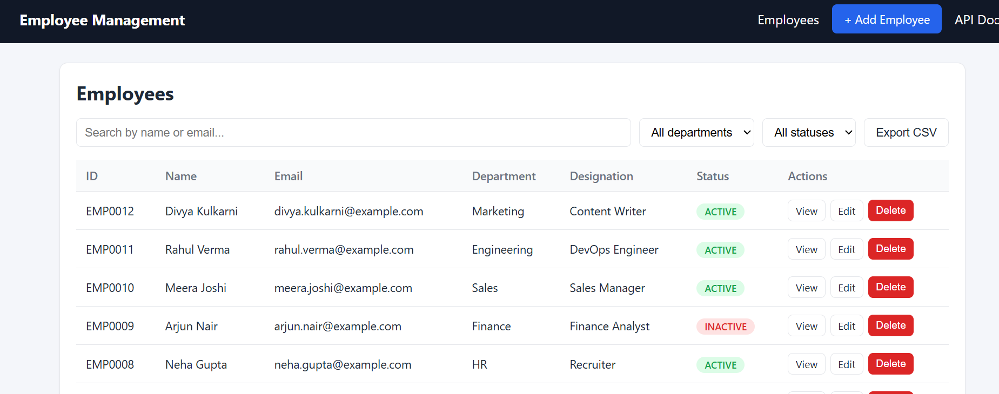
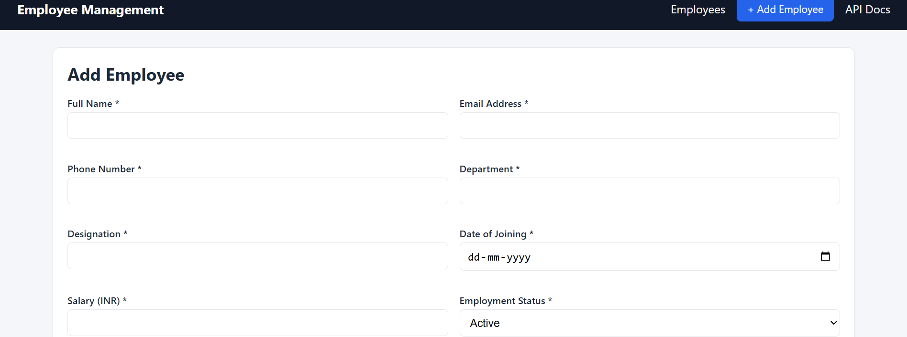
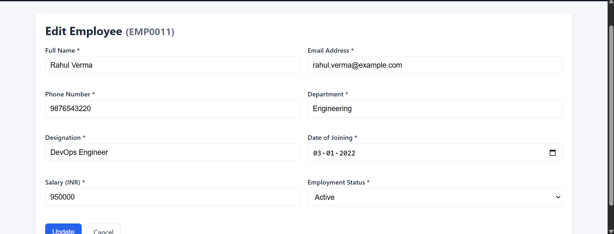
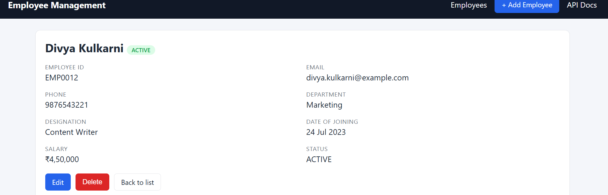
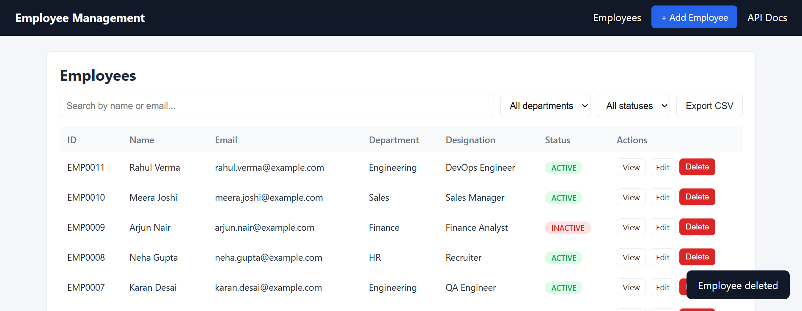
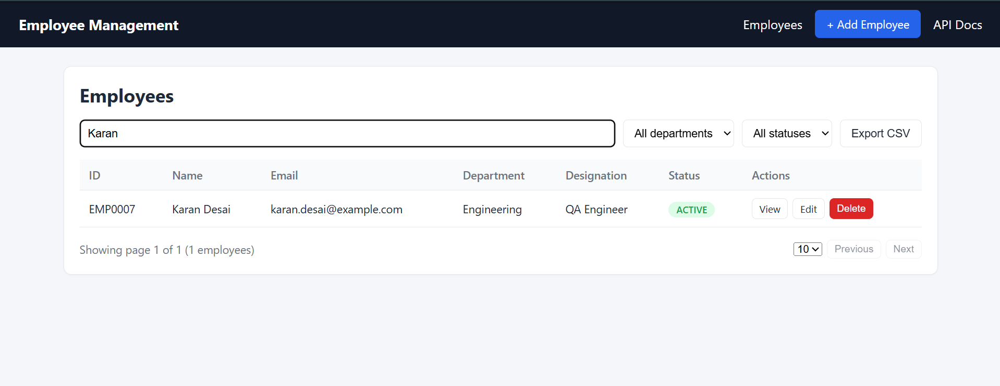
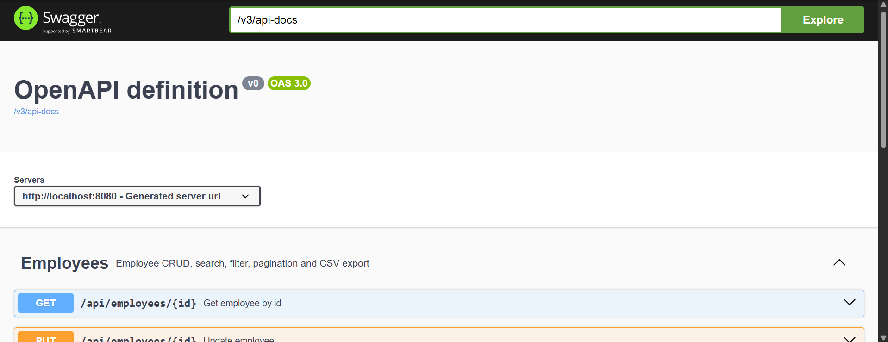
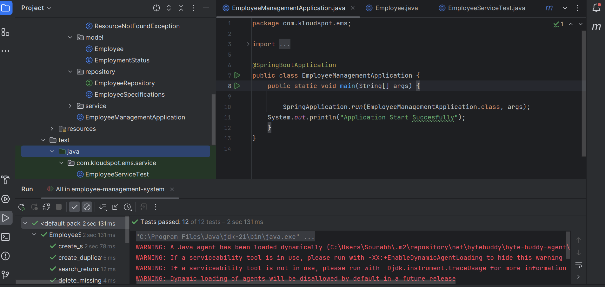

# Employee Management System

Full-stack web application to manage employee records (CRUD) built for the Kloudspot technical assessment.

**Stack:** Java 17, Spring Boot 3.2, Spring Data JPA, MySQL, Maven, Swagger/OpenAPI (springdoc), JUnit 5 + Mockito, vanilla HTML/CSS/JS frontend (served by Spring Boot, so there is nothing extra to install or build for the UI).

## Features

- Add, view, edit, delete (with confirmation dialog) and list employees
- Employee fields: Employee ID (auto-generated, e.g. `EMP0001`), Full Name, Email, Phone, Department, Designation, Date of Joining, Salary, Status (Active/Inactive)
- Search by name or email, filter by department and status, sortable columns, pagination
- Responsive UI (list, add, edit and details pages)
- Server-side validation + friendly JSON error responses (400 / 404 / 409)
- Duplicate email protection
- **Bonus:** CSV export (respects current search/filters), Docker Compose setup, demo data seeding

## Prerequisites

- JDK 17 or later
- Maven 3.8+ (IntelliJ has Maven bundled, so a separate install is not required)
- MySQL 8 (local install, or Docker)
- IntelliJ IDEA (Community or Ultimate)

## Run in IntelliJ IDEA (recommended)

1. **Open the project:** `File > Open` and select the project folder (the one containing `pom.xml`). Choose "Open as Project" and wait for Maven to download the dependencies.
2. **Set the JDK:** `File > Project Structure > Project > SDK` = JDK 17 or later.
3. **Start MySQL** (choose one):
   - Local MySQL: make sure it is running on port 3306.
   - Docker: `docker compose -f docker-compose.db-only.yml up -d` (user `root`, password `root`).
4. **Set your MySQL username and password** if they differ from `root` / `root`: edit `src/main/resources/application.properties`
   or set environment variables `DB_USERNAME` and `DB_PASSWORD` in `Run > Edit Configurations`.
   The database `employee_db` and the tables are created automatically.
5. **Run:** open `EmployeeManagementApplication.java` and click the green run button next to `main`.
6. Open http://localhost:8080

**Run the tests in IntelliJ:** right-click `src/test/java` > `Run 'All Tests'` (or run `mvn test`).

## Run from the command line

```bash
mvn spring-boot:run
```

## Run everything with Docker Compose (app + MySQL)

```bash
docker compose up --build
```

## Quick run without MySQL (in-memory H2, for a quick demo only)

```bash
mvn spring-boot:run -Dspring-boot.run.profiles=h2
```

In IntelliJ: `Run > Edit Configurations > Active profiles` = `h2`.

On first start 12 demo employees are inserted if the table is empty (set `app.seed-data=false` to disable).

## URLs

| What | URL |
|---|---|
| Application UI | http://localhost:8080 |
| Swagger UI | http://localhost:8080/swagger-ui.html |
| OpenAPI JSON | http://localhost:8080/v3/api-docs |

## Running tests

```bash
mvn test
```

Unit tests (JUnit 5 + Mockito) cover the service layer: create, duplicate email, get, update, delete, not-found cases, search, departments and CSV generation/escaping.

## REST API

Base path: `/api/employees`

| Method | Path | Description |
|---|---|---|
| GET | `/api/employees` | List with pagination, search and filters |
| GET | `/api/employees/{id}` | Employee details |
| POST | `/api/employees` | Create (201) |
| PUT | `/api/employees/{id}` | Update |
| DELETE | `/api/employees/{id}` | Delete (204) |
| GET | `/api/employees/departments` | Distinct departments |
| GET | `/api/employees/export` | CSV export |

List query params: `page` (0-based), `size`, `search` (name/email), `department`, `status` (`ACTIVE`/`INACTIVE`), `sortBy`, `direction` (`asc`/`desc`).

### Sample requests (curl)

```bash
# list, page 1, 5 per page
curl "http://localhost:8080/api/employees?page=0&size=5"

# search + filters
curl "http://localhost:8080/api/employees?search=priya&department=Engineering&status=ACTIVE"

# create
curl -X POST http://localhost:8080/api/employees -H "Content-Type: application/json" -d '{
  "fullName": "Test User",
  "email": "test.user@example.com",
  "phoneNumber": "9876500000",
  "department": "Engineering",
  "designation": "Backend Developer",
  "dateOfJoining": "2024-01-15",
  "salary": 750000,
  "status": "ACTIVE"
}'

# update
curl -X PUT http://localhost:8080/api/employees/1 -H "Content-Type: application/json" -d '{ ...same body as create... }'

# delete
curl -X DELETE http://localhost:8080/api/employees/1
```

A ready-to-import Postman collection is in `docs/Employee-Management.postman_collection.json` (set variable `baseUrl` = `http://localhost:8080`).

## Project structure

```
src/main/java/com/kloudspot/ems
  controller/   REST controller
  service/      business logic
  repository/   Spring Data JPA repository + dynamic filter specifications
  model/        JPA entity + enum
  dto/          request / page response objects
  exception/    custom exceptions + global handler
  config/       demo data seeder
src/main/resources/static   frontend (index.html, app.js, style.css)
src/test/java               unit tests
db/setup.sql                database setup script
docs/                       Postman collection + screenshots
Dockerfile, docker-compose.yml
```


## Screenshots

### Employee list


### Add employee (with validation)


### Edit employee


### Employee details


### Delete confirmation


### Search and filter


### Swagger API docs


### Unit tests passed


## Notes / design decisions

- Employee ID is auto-generated from the database id (`EMP0001`...), so admins cannot create clashing ids.
- Email is unique (case-insensitive check in service + unique DB constraint).
- Search/filter uses JPA `Specification`, so all filters combine with pagination in a single query.
- CSV export neutralises spreadsheet formula injection (cells starting with `=`, `+`, `-`, `@`).
